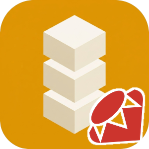

# Identisure Ruby Client

[![Gem version][gem-image]][gem-url]
[![MIT license][license-image]][license-url]

[gem-image]: https://img.shields.io/gem/v/identisure-client?style=flat-square
[gem-url]: https://rubygems.org/gems/identisure-client
[license-image]: https://img.shields.io/badge/license-MIT-blue?style=flat-square
[license-url]: https://opensource.org/license/mit

API client for the [Identisure](https://developers.identisure.com) REST API.

## Requirements

Ruby 3.2 or later.

## Supported providers

- **BankID SE**: auth, sign, phone auth and sign, QR verify, age verification
- **BankID NO**: auth, backchannel auth, sign, age verification
- **Freja eID**: auth, backchannel auth, sign, backchannel sign, age verification
- **MitID**: auth, backchannel auth, sign, age verification
- **FTN** (Finnish Trust Network): auth, age verification
- **Vipps MobilePay**: auth, backchannel auth
- **Documents**: upload and download documents for signing

## Installation

```sh
gem install identisure-client
```

Or add to your `Gemfile`:

```ruby
gem 'identisure-client', '~> 0.1'
```

## Usage

```ruby
require 'identisure/client'

client = Identisure::ClientBuilder.new('client_id', 'client_secret')
                                  .environment(Identisure::Environment::STAGING)
                                  .build

session = client.bank_id_se.auth(Identisure::BankIdSe::AuthRequest.new)
puts "Session ID: #{session.id}" if session.is_a?(Identisure::BankIdSe::Pending)

result = client.bank_id_se.wait_for_auth(session.id)

case result
in Identisure::BankIdSe::Completed(ssn:, name:)
  puts "Authenticated: #{name} (#{ssn})"
in Identisure::BankIdSe::Failed(error:)
  puts "Failed: #{error}"
end
```

### Verifying callbacks

Verify the `X-Signature-SHA256` header against the raw request body before parsing it:

```ruby
valid = Identisure.verify_callback_signature(raw_body, signature_header, 'hmac_secret')
```

## Development

### Prerequisites

- Ruby 3.2+
- Bundler

### Setup / Build / Test

The test fixtures live in a Git submodule. Clone with `--recurse-submodules`, or run `git submodule update --init` in an existing clone.

```sh
bundle install
bundle exec rake test
```

## Other languages

[C#](https://github.com/identisure/api-client-csharp), [Dart](https://github.com/identisure/api-client-dart), [Go](https://github.com/identisure/api-client-go), [TypeScript/JavaScript](https://github.com/identisure/api-client-js), [Java/Kotlin](https://github.com/identisure/api-client-jvm), [PHP](https://github.com/identisure/api-client-php), [Python](https://github.com/identisure/api-client-py), [Rust](https://github.com/identisure/api-client-rust), [Swift](https://github.com/identisure/api-client-swift)
